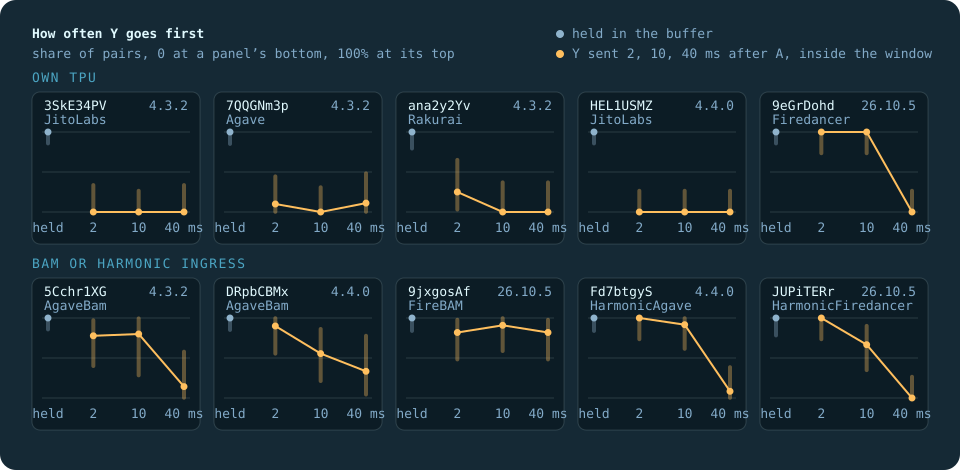

# Inside the Block

How ten Solana validators on eight clients order the transactions in their blocks, measured on mainnet after Alpenglow with our
own transactions. Written for the Superteam Ukraine bounty of the same name. The numbers are in [REPORT.md](REPORT.md).

A 4:30 video walks through the method and the results: [Inside the Block on YouTube](https://youtu.be/Qy4snotpZkc).

I wanted to know whether money buys a place in a Solana block, or whether it goes to whoever arrives first. Public measurements
disagree on this, so I set out to find out why, with a measurement anyone can check.

I sent pairs of my own transactions into a single leader's window, priced so that each candidate rule would put a different one
first. Some pairs reached the leader just before its block, others while the block was already being built. Before trusting the
method, I tested it on a question with a known answer (90 of 90 against 46 of 90), and every plan was frozen in an on-chain Memo
before the first transaction. It all ran from a battery-backed home server in Kyiv, where planning around Solana's leader schedule
turned out easier than planning around the blackout schedule.

It turns out that when the leader holds both transactions at once, all ten validators sort them by reward per unit of cost. When
the block is already being built, Agave, JitoLabs and Rakurai take them in the order they arrive, while the others work in batches
of tens of milliseconds. That is most likely why public measurements disagree: a transaction sent through an RPC node often reaches
the leader mid-block.

Everything here reproduces with [one command](#check-it-yourself), and every pair can be checked on chain with `getBlock`.

<p align="center"></p>

The same pair at two moments. Sent about a second before the leader's slot, both members wait in its buffer and its sort decides.
Sent while it is producing, they are taken as they come. Block P measures both.

## Results at a glance

Three sessions on 1 to 3 November, 1,263 scored pairs. Held together, every validator ranks our transactions by reward per unit of
cost. Arriving apart while the block is being built, they are taken in arrival order on Agave, JitoLabs and Rakurai, and in batches of
tens of milliseconds elsewhere.

| Validator | Client and version | Ingress | Ordered by | Strict | At equal priority | Inside the window | Scored pairs |
|---|---|---|---|---|---|---|---:|
| `3SkE34PV` | JitoLabs 4.3.2 | own TPU | reward per cost | yes | no relation | arrival order | 138/144 |
| `HEL1USMZ` | JitoLabs 4.4.0 | own TPU | reward per cost | yes | arrival order | arrival order | 143/144 |
| `7QQGNm3p` | Agave 4.3.2 | own TPU | reward per cost | yes | no relation | arrival order | 136/144 |
| `ana2y2Yv` | Rakurai 4.3.2 | own TPU | reward per cost | yes | no relation | arrival order | 96/96 |
| `9eGrDohd` | Firedancer 26.10.5 | own TPU | reward per cost | yes | reverse arrival | batch of about 40 ms | 144/144 |
| `5Cchr1XG` | AgaveBam 4.3.2 | BAM | reward per cost | yes | no relation | batch of about 45 ms | 128/144 |
| `DRpbCBMx` | AgaveBam 4.4.0 | BAM | reward per cost | yes | reverse arrival | batch of about 50 ms | 126/144 |
| `9jxgosAf` | FireBAM 26.10.5 | BAM | reward per cost | yes | no relation | batch over 78 ms | 129/144 |
| `Fd7btgyS` | HarmonicAgave 4.4.0 | Harmonic | reward per cost¹ | yes | no relation | batch of about 45 ms | 117/144 |
| `JUPiTERr` | HarmonicFiredancer 26.10.5 | Harmonic | reward per cost¹ | yes | no relation | batch of about 36 ms | 106/144 |

¹ C4, C6, S and v1 fit reward per cost on Harmonic, but K went the other way in 7 of 7 pairs, so the key there is close to the Agave key
and not the same. `ana2y2Yv` sat out session 3 after it moved to Rakurai 4.4.0. Every count, interval and sensitivity view is in
[REPORT.md](REPORT.md) and [`report/P/summary.md`](report/P/summary.md).

Read this before quoting a number:

- A verdict describes the path we measured: one unstaked sender writing straight to the leader's TPU, or to the BAM or Harmonic
  ingress in front of it.
- Our transactions are small, untipped and touch only fresh accounts. Bundles, heavy transactions and contended accounts are
  outside the study.
- A verdict is about one validator in the sessions it ran in, not about every validator on its client.
- The full list is under [What this does not separate](#what-this-does-not-separate).

## Check it yourself

```bash
docker compose up --build
```

That builds the image and runs the tests, the power tables and `tools/reproduce.py` in a container with no network, no keys and a
read-only file system.
`reproduce.py` recomputes the frozen digests from the files in this repository and compares them with the two on-chain Memos, checks
every raw file against its manifest, recomputes every send-order coin from the seed, verifies every signature in the journals,
recomputes every fee and priority from the signed bytes, and recomputes every verdict from `outcomes.jsonl`.

What needs the chain runs outside that container, through any RPC:

```bash
python tools/reproduce.py --chain
```

```bash
python -m tiepairs verify data/T/20261101T080507Z-live-9ddx
```

```bash
python -m tiepairs verify data/P/20261103T021507Z-live-7e8x
```

The first reads the Memos back. The second calls `getBlock` for every slot in a run and checks each signature's slot, index and leader
against the outcome file. All raw data is under `data/`, with signatures and slot numbers.

The freeze does not rest on this repository's history. Block T's Memo is in slot 464,002,340 and its first probe in slot 464,018,360.
Block P's Memo is in slot 464,169,852 and its first probe in slot 464,170,012. `reproduce.py --chain` recomputes the digests from the
files here and reads them back from those Memos.

Any single pair can be checked by hand. The first pair of block P (`seq` 0 in its `outcomes.jsonl`) landed in slot 464,170,012:

```bash
curl -s https://api.mainnet-beta.solana.com -H 'Content-Type: application/json' -d '{"jsonrpc":"2.0","id":1,"method":"getBlock","params":[464170012,{"encoding":"json","transactionDetails":"signatures","rewards":false,"maxSupportedTransactionVersion":1}]}'
```

Its two signatures are at indexes 10 and 11 of the 359 in `result.signatures`. That index, counted from 0, is the position the
report uses.

## Why this design

A block shows where a transaction landed and not why. Other people's transactions carry no send time, so reading them gives
correlations, and a single probe of our own has nothing to be compared with. The unit here is a pair: two of our transactions
aimed at one leader window, both write-locking the same fresh account, so the scheduler has to put one before the other.
Their priced fields are chosen so that candidate keys disagree about which goes first, and the order in the block names the key.

Two contrasts are enough to separate the keys the published work considered:

| Contrast | Reward ÷ cost | CU price | Lamport fee | Cost alone | Arrival, no rule |
|---|---|---|---|---|---|
| C4: Y against A | Y | Y | Y | A | either |
| C6: D against A | A | D | D | A | either |

C6 is new. D pays more than A on CU price and on lamports and asks for 64 MiB of loaded data, so it has less reward per unit of cost.
It sets the ratio against both alternatives at once. The other kinds ask narrower questions: E is two identical probes for the
tie-break, K sets the ratio against an additive key, VH and VL put a v1 transaction a fraction of a percent above and below a legacy
one, S1 and S2 ask how much of the signature fee counts as reward, and W2, W10 and W40 measure how long a sort can wait inside the
window. [hypotheses/H6.md](hypotheses/H6.md) has the probe table and every decision rule.

The study has two blocks. Block T ([H5](hypotheses/H5.md)) tests a prediction with a known answer: Agave
[#14836](https://github.com/anza-xyz/agave/pull/14836) makes equal-priority transactions leave in arrival order from v4.4.0 on, and that
can be seen from outside only if the instrument works. So it doubles as the calibration of everything that follows. Block P is the
measurement the bounty asks for, with one uniform design on ten validators.

Each block is frozen before its first probe. The SHA-256 of its hypotheses, of its code and of its target list went into a Memo on
mainnet, the same hash seeds every coin, and the program refuses to send if any of the three changed. So the decision rules could
not move after the data arrived, and anyone can check that from the chain.

### Two regimes, two answers

Public measurements of this question disagree. Most of those we read that send through an RPC node report arrival order on
Agave-based leaders, and those that write straight to the leader's TPU before its slot report a fee rule. Both can be right, because
they catch the leader at different moments. An RPC node forwards a transaction when it receives it, so the sender does not choose
when it reaches the leader, and it can arrive while the block is already being built.

This design has both moments on purpose. A buffered pair is in the leader's buffer before slot F begins, so the scheduler sees both
members at once and its key decides. A window pair (W2, W10, W40) reaches a leader that is already producing, with the better member
sent 2, 10 or 40 ms after the other, so the better member can win only if the scheduler takes both in one batch. The share it wins at
each gap is a curve, and `tools/horizon.py` fits a batch period to it for each validator.

<p align="center"></p>

Held in the buffer, the better member went first in 215 of 215 C4 pairs. Sent 2 to 40 ms later into a running window, it overtook 4 times
in 119 on JitoLabs, Agave and Rakurai, every time at 2 and 10 ms and never at 40 ms on Firedancer, and in between on BAM and Harmonic.
Validators and probes are the same in both cases. What changes is when the pair reaches the leader.

## What the bounty asks to account for

### Leader schedule and leader types

`getLeaderSchedule` gives each target's slots for this epoch and the next. Only the first window of a leader run is used, because only
there does the previous slot belong to someone else, so a pair can sit in the buffer until the validator starts producing. Windows of
one target stay at least 1,200 slots apart, so a large validator's pairs span the same hours as a small one's.

A leader's type comes from gossip: `clientId`, version and advertised `tpuQuic`, checked before the plan and again before each window.
A target that shows another client or version when a run starts is left out of that run. A pair whose leader shows another client
or version at its window check is cancelled with the reason `version_changed`, and the next window checks again. The ten targets cover Agave, JitoLabs, Firedancer,
Rakurai, AgaveBam, FireBAM, HarmonicAgave and HarmonicFiredancer. Five take transactions on their own TPU and five on the shared
ingress of BAM or Harmonic. Validators behind a Jito Relayer were kept out of the main comparison after the passive data showed they
behave differently, and three of them ran as a separate arm of block T.

The clock is `getSlot` polling plus a WebSocket stamp per slot. A pair is cancelled, not sent late, if the anchor slot was missed or the
clock is stale. Every cancellation is recorded with its reason.

### The path from us to the node that executes

One host sends directly over QUIC to the leader's `tpuQuic`, with no RPC node, no staked relay and no Jito. The sender holds no stake.
Each window gets its own connection, opened about 7 s before the pair and closed after it, because left open, connections to different
validators reached different ages and the comparison between groups would have carried that. Both members travel on one connection,
10 ms apart.

Two regimes remove or use arrival on purpose. In the buffered regime a pair is fired when slot F−5 is first seen, about 1 s before
the first shred of F, so both members wait in the leader's buffer and the sort sees them together. In the window regime a pair is
fired when F is seen, so the two arrive at different moments of a running leader. The same design runs on shared ingress, because
inside the window a 10 ms head start would read as the rule on a sort that batches.

The run samples RTT every 10 ms around each pair, and the report gives an empirical bound on how often the network alone could have
swapped two packets. What happens between the socket and the scheduler is not observed. Where the path is a builder, a verdict
describes the path as a whole.

### The interaction of our own transactions

Two payers, so neither member can be held back by the other's fee payer lock. One lock account per pair, so no pair ever touches
another's state. At least 40 slots between any two pairs, so the payers never overlap. The lock is the only thing the two members
share, and it is what forces an order: without it they could run in parallel and their order would mean nothing.

### Competition inside the block

Other senders are not controlled and do not need to be. The lock account is fresh, so nobody else contends for it, and a pair's result is
the relative order of its two members, which outside traffic can shift only as a whole. A probe still has to land, and `tools/competition.py`
reads every block we landed in and reports how far from the top each probe stood, how it ranked by priority against everyone else, how many
cheaper transactions went ahead of it and how many dearer ones stayed behind. Its arithmetic is checked on our own probes, which must
come out at the priority in the journal. Pairs that did not land stay in the data under their own class.

### Send order

Which payer goes first is the parity of one byte of `sha256(seed:identity:first_slot)`, which payer carries the better template is the
parity of the next, and the seed is the hash of the frozen file. So send order is randomized, independent of the template, and
auditable by anyone. The report tests the balance per validator and gives the share of pairs won by the first-sent member, so arrival
is measured and not assumed away. The curve is the exception by design: the better probe always goes second, because the question
there is how often it overtakes.

### Noise against rule

"No rule" is a planned outcome. Each validator gets one of: reward per cost, price or fee, cost alone, arrival, reverse arrival, partial,
mixed, no rule seen, undetermined, not evaluable or withdrawn. No rule seen needs both 95% intervals inside (0.20, 0.80), and
undetermined means there were too few pairs to tell a null from a weak rule. Tests are exact binomial with Holm over the whole planned
family, with a validator that sent nothing still counted as a test that found nothing. Strictness is a separate reading: the winner's share
must reach 0.80 on both contrasts.

Block T gives the instrument a control: the same design on the same client, with versions on both sides of the change. The treated
validators gave 90 of 90 and the controls 46 of 90, so a coin looks like a coin and a rule looks like a rule. Each report also shows
what happens if every pair that lost a member is counted against the prediction, and repeats the contrasts on pairs in one slot,
pairs with a lead of at least 150 ms, pairs within 1 ms of the planned gap and pairs on a settled connection.

## Threats to validity

| Threat | How the design handles it | Where to see it |
|---|---|---|
| The instrument cannot tell a rule from noise | Block T: a rule known in advance on 4.4.0, and the same design on 4.3.2, where it is absent | REPORT, block T: 90/90 against 46/90 |
| Decision rules move after the data | Hypotheses, code and targets frozen on chain before the first probe; a run refuses to start if any of them changed | Memos in slots 464,002,340 and 464,169,852 |
| Send order decides instead of the rule | A coin seeded by the frozen hash picks the member sent first; the first-sent share is reported | per validator in `report/P/summary.md` |
| Connections of different ages | Each window opens its own connection about 7 s before the pair | REPORT, the settled-connection view |
| Our two transactions hold each other back | Two fee payers; the fresh lock account is the only state they share | `payer` and `lock` in `probes.jsonl` |
| Other senders touch our accounts | A new lock account for every pair | `lock` in `probes.jsonl` |
| The network swaps the two packets | Both members on one connection, 10 ms apart, RTT sampled every 10 ms around the pair | REPORT, the swap bound of each run |
| A late or stale slot clock | The pair is cancelled, not sent late, with the reason recorded | `cancel` in `outcomes.jsonl` |
| The leader is not what gossip said | Client, version and address checked before the plan and before every window; a changed target sits out the run, a changed leader cancels its pair | `gossip_plan` and `gossip_window` per pair |
| One client label hides different operators | A verdict per validator, pooled only where H6 says so | Results at a glance |
| The sending host changed between sessions | Recorded, and every pair carries its own gap and RTT | REPORT, "During block P" |

## Power and coverage

Each validator gets 48 pairs in each of three sessions, 144 in all: 24 each of C4, C6 and E, 12 at each window gap, 9 each of S1 and
S2, and 6 each of K, VH and VL. `python -m tiepairs power` prints what those counts can detect under the frozen Holm family.

H6's simulation, frozen with the plan: with both probes landing in 80% of pairs, a validator that follows the rule in 95% of pairs is
named in 99.5% of simulated validators, and in 85.5% at 60% landing. In the run 1,263 of 1,392 planned pairs were scored. Every
validator landed above 80% except `JUPiTERr` at 74%, and `ana2y2Yv` stopped at 96 pairs when it sat out session 3.

Ten validators are few, yet together they lead close to a fifth of the slots. `tools/coverage.py` reads the leader schedule of epoch 1075, when
sessions 2 and 3 ran, and a gossip snapshot, both saved under `data/coverage/`. Our ten lead 80,884 of its 432,000 slots, 18.7%, and
the eight clients they run lead 99.8%:

| Client in gossip | Leader slots | Share | Held by our ten | Of that client |
|---|---:|---:|---:|---:|
| AgaveBam | 156,248 | 36.2% | 18,952 | 12% |
| JitoLabs | 94,528 | 21.9% | 19,552 | 21% |
| HarmonicAgave | 91,620 | 21.2% | 16,984 | 19% |
| HarmonicFiredancer | 46,956 | 10.9% | 9,524 | 20% |
| Firedancer | 23,796 | 5.5% | 6,872 | 29% |
| FireBAM | 8,480 | 2.0% | 4,464 | 53% |
| Rakurai | 5,216 | 1.2% | 2,552 | 49% |
| Agave | 4,304 | 1.0% | 1,984 | 46% |
| Three others | 852 | 0.2% | 0 | 0% |

Gossip labels are self-reported and change: the snapshot is from 3 November 08:44, after the last session.

## Predicted from source

For Agave, JitoLabs and Firedancer, H6 took each prediction from the client's code before any pair was sent, so a match is a test
passed and not a pattern found afterwards. The BAM and Harmonic ingress and Rakurai publish no sort, so there the Agave key is the
hypothesis under test.

- On Agave and JitoLabs, `calculate_priority_and_cost` gives reward × 1,000,000 ÷ (cost + 1). The reward is the priority fee plus
  the half of the signature fees that is not burned, and the cost comes from the cost model with the requested compute limit and the
  requested loaded-data size ([v4.3.2, `core/src/transaction_priority.rs`, lines 32 to 66](https://github.com/anza-xyz/agave/blob/v4.3.2/core/src/transaction_priority.rs#L32-L66),
  unchanged in v4.4.0). On top of the compute limit the cost counts 720 per signature, 300 per write lock and one unit per 4 bytes
  of instruction data ([`block_cost_limits.rs`](https://github.com/anza-xyz/agave/blob/v4.3.2/cost-model/src/block_cost_limits.rs#L8-L20)),
  and 8 per 32 KiB of requested loaded data. C4, C6, K, S, VH and VL are priced against this key.
- On Agave 4.3.2, `TransactionPriorityId` orders by priority and then by an internal id, not by arrival
  ([lines 4 to 8](https://github.com/anza-xyz/agave/blob/v4.3.2/core/src/banking_stage/transaction_scheduler/transaction_priority_id.rs#L4-L8)).
  Block T's controls came out at 46 of 90.
- On Agave 4.4.0 the same struct gains `arrival_order`, and among equal priorities the oldest goes first
  ([lines 21 to 28](https://github.com/anza-xyz/agave/blob/v4.4.0/core/src/banking_stage/transaction_scheduler/transaction_priority_id.rs#L21-L28),
  [#14836](https://github.com/anza-xyz/agave/pull/14836)). Block T's treated validators came out at 90 of 90.
- On Firedancer 26.10.5 the reward is half of the signature fees plus the priority fee
  ([`fd_pack.c`, lines 1040 to 1063](https://github.com/firedancer-io/firedancer/blob/v26.10.5/src/disco/pack/fd_pack.c#L1040-L1063),
  with `FD_PACK_TXN_FEE_BURN_PCT` at 50 in [`fd_pack.h`](https://github.com/firedancer-io/firedancer/blob/v26.10.5/src/disco/pack/fd_pack.h#L42)),
  and two transactions are compared by cross-multiplying reward and cost, without the + 1
  ([line 227](https://github.com/firedancer-io/firedancer/blob/v26.10.5/src/disco/pack/fd_pack.c#L227)).

## What this does not separate

- A builder's sort cannot be told from the scheduler behind it, so BAM and Harmonic are reported as the ingress path we measured.
- The send gap is observed and the RTT is sampled, but the moment a transaction reached the scheduler is not.
- Our probes are small, untipped, unstaked and carry one or two signatures. Heavy transactions, bundles and contended accounts are
  outside this study, and Jito bundles and tips are out of scope by the bounty's own rules.
- K excludes an additive key only for λ below 2.5, and the published work excludes λ above 10. Between them other keys stay open.
- S gives a bracket for the signature share, not its exact value, and it assumes the key's cost holds the 720 units of a signature.
- A difference between two validators has no single cause: two validators on two versions differ in operator, load and settings too.
- `clientId` and version are self-reported, so what a client really runs is confirmed only by how it behaves.
- The curve has no in-window control, and a swap inside a validator's stream handling would read as overtaking.
- No pair went through an RPC node. What this report says about measurements that do is inferred from our window pairs and timing,
  not measured.
- A verdict covers the sessions it ran in.

## Layout

| Path | What it holds |
|---|---|
| `hypotheses/` | H5 and H6, the frozen plans, and the data behind the choice of controls |
| `tiepairs/` | Block P's code as frozen: sender, ledger, journal, analysis |
| `frozen/T/` | Block T's code as frozen, in full, because its digest is on chain |
| `tools/` | `reproduce.py`, `competition.py`, `horizon.py`, `coverage.py` and `figures.py`. Outside the frozen digest, on purpose |
| `data/` | Every run: journals with signed bytes, probes, RTT, connections, slot stamps, outcomes, manifests, plus the ledger, the Memos and the coverage snapshot |
| `report/` | Reports recomputed from `data/` |
| `figures/` | Figures for this README and the report, written by `tools/figures.py` |
| `tests/` | The test suite, including crash tests that kill the sender at each step |
| `localnet/` | Real Agave validators for the whole path, with free SOL |

Each run's `journal.jsonl` holds the signed bytes of every pair before it could leave, `probes.jsonl` one line per probe with send time,
connection and leader address, `rtt.jsonl` the RTT samples, `links.jsonl` every connection opened and closed, `stamps.jsonl` the first-shred stamps,
and `outcomes.jsonl` and `probes.final.jsonl` every pair's class and every reason it could be excluded, each as its own field.

## Running it yourself

Everything is a dry run unless `--live` is given, and only `fund`, `prereg`, `run` and `sweep` accept it. A dry run uses real slots, blockhashes,
signatures and QUIC handshakes and stops short of writing a stream:

```bash
TIEPAIRS_ENV_FILE=./rpc.env docker compose --profile dryrun run --rm dryrun
```

`rpc.env` holds `TIEPAIRS_RPC` and is optional, the public RPC is the default. Keys come only through the volume of the `live` profile and
never enter the image:

```bash
TIEPAIRS_SECRETS_DIR=./secrets TIEPAIRS_OUT_DIR=./out docker compose --profile live run --rm live --block P run --session 1 --live
```

The path developed as the bounty suggests: real validators on a local cluster for the pipeline, mainnet dry runs for the timing, then
mainnet with the cap:

```bash
docker compose --profile localnet up -d localnet-440
```

```bash
localnet/e2e.sh 4.4.0
```

A lone local validator leads every slot, so nothing waits in a buffer there. That run tests the path and not the hypotheses.

## Spending and safety

- Sending needs a `LiveAuthorization`, and only `guard.authorize` gives one, after checking `--live`, the ledger and its cap, the key, the mainnet
  genesis hash and that the slot is past Alpenglow. All measurements are after it.
- The cap is enforced in code: 0.05 SOL for the whole measurement across every run and block, and a smaller one per block. The ledger is a single
  file behind an exclusive lock, so a second process cannot run beside the first.
- For each pair the signed bytes reach the disk first, then the worst-case fee reaches the ledger, and only then may anything leave. A
  reservation comes back only if this process knows nothing reached a socket. After a crash whatever may have left stays charged and is never resent.
- Every template passes `simulateTransaction` and `getFeeForMessage` before a run, in dry runs too, and any difference stops it.
- The sender stays under the unstaked limits: at most 5 new connections per IP per minute and 14 streams per 100 ms.
