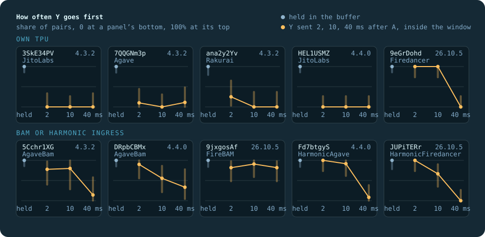

# Report

All times are UTC, November 2026. All measurements are on mainnet after Alpenglow. It switched on at slot 459,653,000, the eight slots
from there produced no block, and the first block after the switch is 459,653,008, which is the threshold below which the program
refuses to send.
Every number here comes from `data/` and can be recomputed with `tools/reproduce.py`.

## Every measurement

| Date and time | What | Run | Pairs | Slots |
|---|---|---|---:|---|
| 1 Nov 08:05 to 08:10 | Block T, first pairs, one per target | `20261101T080507Z-live-9ddx` | 9 | from 464,018,360 |
| 1 Nov 08:10 to 13:30 | Block T, main run | same | 261 | to 464,109,208 |
| 1 Nov 17:06 to 17:12 | Block P, session 1, first pairs | `20261101T170628Z-live-4cbx` | 10 | from 464,170,012 |
| 1 Nov 17:15 to 2 Nov 00:23 | Block P, session 1, main run | same | 470 | to 464,292,276 |
| 2 Nov 09:04 to 16:13 | Block P, session 2 | `20261102T090425Z-live-021x` | 480 | 464,438,304 to 464,558,312 |
| 3 Nov 02:15 to 08:41 | Block P, session 3 | `20261103T021507Z-live-7e8x` | 432 | 464,726,896 to 464,835,396 |

Frozen before the first probe of each block: the Memo of block T in slot 464,002,340 and the Memo of block P in slot 464,169,852.

## Block T: is the instrument able to read a rule?

Agave [#14836](https://github.com/anza-xyz/agave/pull/14836) orders equal-priority transactions by arrival from v4.4.0 on. If that is true on
mainnet and our instrument works, two identical probes sent 10 ms apart must land in send order on 4.4.0 and in no fixed order on
4.3.2. The rule was frozen in [H5](hypotheses/H5.md) before the first probe.

| Group | Validators | First-sent landed first | Share | 95% interval |
|---|---|---:|---:|---|
| JitoLabs 4.4.0, direct | `HEL1USMZ`, `E1r4Psq8`, `bitHUmbK` | 90/90 | 1.00 | 0.96 to 1.00 |
| JitoLabs 4.3.2, direct | `3SkE34PV`, `8gDfqHXZ`, `privaEdS` | 46/90 | 0.51 | 0.40 to 0.62 |
| JitoLabs 4.3.2, behind a relayer, outside the decision | `EvnRmnMr`, `5pPRHnie`, `GnC339vk` | 46/74 | 0.62 | 0.50 to 0.73 |

The verdict under H5 is that the prediction holds. Fisher's exact test gives one-sided p = 4.9e-17, and each treated validator went
30 of 30. All frozen conditions hold: p below
0.01, treated share at least 0.80, difference at least 0.20, every treated validator at least 0.80 on at least 10 pairs, median gap 9.82 ms
in both groups. The treated and control groups lost no pair, so the worst-case view equals the primary one. `verify` read all 512 blocks
back and found no discrepancy.

So at equal priority 4.4.0 keeps arrival order on mainnet, and 4.3.2 is close to a coin. The instrument read a rule known in advance,
and a coin as a coin, which is what lets block P be believed. On 4.3.2 the three validators differ more than a shared rate would
suggest (15/30, 11/30, 20/30), and we make no claim about why.

The relayer group must be read with care. `5pPRHnie` and `GnC339vk` close an idle unstaked connection within about a second, so 46 of its 74 scored
pairs travelled on a connection younger than 5 s, and it lost 14 pairs that never landed. Its settled view is `EvnRmnMr` alone, 22/28.
That is one validator, and it is not a figure for relayers.

## Block P: what orders each validator?

The same design on ten validators of eight clients, frozen in [H6](hypotheses/H6.md) before the first probe: three sessions at
different hours within 48 hours, 48 pairs per validator in each. Of 1,392 pairs of the plan 1,391 went out, one of them without its
second member, and 1,263 were scored, 91%. Rakurai `ana2y2Yv` sat out session 3 after it moved to a new version, so its verdict rests on 96 pairs, and one pair on
`5Cchr1XG` was cancelled when its leader showed another client. `verify` read all 2,678 blocks back and checked 2,782 signatures,
with no discrepancy.

| Validator | Client | Ingress | Named | Strict | C4: Y first | C6: D first | K: K-x first | Ties: first-sent first | Tie-break |
|---|---|---|---|---|---:|---:|---:|---:|---|
| `3SkE34PV` | JitoLabs 4.3.2 | own TPU | reward per cost | yes | 24/24 | 0/24 | 6/6 | 12/24 | no relation |
| `HEL1USMZ` | JitoLabs 4.4.0 | own TPU | reward per cost | yes | 24/24 | 0/24 | 6/6 | 24/24 | arrival |
| `7QQGNm3p` | Agave 4.3.2 | own TPU | reward per cost | yes | 23/23 | 0/24 | 6/6 | 14/24 | no relation |
| `ana2y2Yv` | Rakurai 4.3.2 | own TPU | reward per cost | yes | 16/16 | 0/16 | 4/4 | 6/16 | no relation |
| `9eGrDohd` | Firedancer 26.10.5 | own TPU | reward per cost | yes | 24/24 | 0/24 | 6/6 | 0/24 | reverse arrival |
| `5Cchr1XG` | AgaveBam 4.3.2 | BAM | reward per cost | yes | 24/24 | 0/24 | 6/6 | 8/23 | no relation |
| `DRpbCBMx` | AgaveBam 4.4.0 | BAM | reward per cost | yes | 23/23 | 0/21 | 5/5 | 4/24 | reverse arrival |
| `9jxgosAf` | FireBAM 26.10.5 | BAM | reward per cost | yes | 21/21 | 0/20 | 5/5 | 8/23 | no relation |
| `Fd7btgyS` | HarmonicAgave 4.4.0 | Harmonic | reward per cost | yes | 21/21 | 0/18 | 0/4 | 5/16 | no relation |
| `JUPiTERr` | HarmonicFiredancer 26.10.5 | Harmonic | reward per cost | yes | 15/15 | 0/16 | 0/3 | 10/14 | no relation |

Intervals and every other table are in [`report/P/summary.md`](report/P/summary.md), recomputed from `data/P` by `tools/reproduce.py`.

The verdict under H6 is that every validator orders by reward per cost, strictly. The probe with more reward per unit of cost went first in
215 of 215 scored C4 pairs, and the one that pays more but costs more went first in 0 of 211 C6 pairs. That holds on every validator,
in every session, and in every sensitivity view: pairs in one slot, a lead of at least 150 ms, a gap within 1 ms of 10 ms, and a
connection at least 5 s old. No C4 or C6 pair lost only one member, so the worst-case view equals the primary one. The median gap of
buffered pairs was 10.13 to 10.17 ms on every validator, inside the 1 ms the rules allow.

For ties, H6 predicted arrival order on `HEL1USMZ`, as in block T, and reverse arrival on `9eGrDohd`. Both hold, 24 of 24 and 0 of
24. The three other validators on their own TPU run 4.3.2 and show no relation (12/24, 14/24, 6/16), as their code and block T's
controls predict. Behind an ingress the tie rule of the client inside does not survive. `DRpbCBMx` runs Agave 4.4.0, which keeps
arrival order, yet came out as reverse arrival, 4 of 24, so its BAM ingress hands equal transactions over the other way round. No
prediction named it. FireBAM, HarmonicAgave 4.4.0 and HarmonicFiredancer show no relation, although Firedancer and JitoLabs 4.4.0 on their
own TPU each show one. On `7QQGNm3p` the share moved between sessions (1/8, 8/8, 5/8), and we make no claim about why.

On the signature fee, a probe with two signatures beat A in 79 of 79 S1 pairs and lost to S-one in 80 of 80 S2 pairs. Under reward per
cost that brackets the share of the signature fees counted as reward between 0.38 and 0.76, both on the four validators whose source
we read (35/35 and 0/36) and on the six whose sort we could not read (44/44 and 0/44): half, as predicted.

K went the way the ratio predicts. Over the validators named reward per cost, K-x went first in 44 of 51 pairs (0.74 to 0.94,
p = 1.2e-07), against a prediction of at least 0.80. All 44 came from the eight validators outside Harmonic. On the two Harmonic validators K-y went first in all 7.

A v1 transaction 0.17% above a legacy one in priority went first in 54 of 54 pairs, and one 0.26% below went first in 0 of 55,
on clients built on Agave (38/38 and 0/38) and on Firedancer (16/16 and 0/17). v1 is ranked by the same key, to a fraction of a percent.

### Inside the window

| Validator | Client | Y first, held (C4) | Y sent 2 ms later | 10 ms | 40 ms | Batch period B, ms | 95% range |
|---|---|---:|---:|---:|---:|---:|---|
| `3SkE34PV` | JitoLabs 4.3.2 | 24/24 | 0/9 | 0/12 | 0/9 | about 1 | 1 to 2.5 |
| `HEL1USMZ` | JitoLabs 4.4.0 | 24/24 | 0/12 | 0/12 | 0/12 | about 1 | 1 to 2 |
| `7QQGNm3p` | Agave 4.3.2 | 23/23 | 1/10 | 0/10 | 1/9 | 2.5 | 1 to 3 |
| `ana2y2Yv` | Rakurai 4.3.2 | 16/16 | 2/8 | 0/8 | 0/8 | 3 | 2.5 to 5 |
| `9eGrDohd` | Firedancer 26.10.5 | 24/24 | 12/12 | 12/12 | 0/12 | 40 | 29 to 51 |
| `JUPiTERr` | HarmonicFiredancer 26.10.5 | 15/15 | 12/12 | 8/12 | 0/12 | 36 | 18.5 to 46.5 |
| `Fd7btgyS` | HarmonicAgave 4.4.0 | 21/21 | 12/12 | 11/12 | 1/12 | 44.5 | 37 to 64 |
| `5Cchr1XG` | AgaveBam 4.3.2 | 24/24 | 7/9 | 4/5 | 1/7 | 45.5 | 19.5 to 70 |
| `DRpbCBMx` | AgaveBam 4.4.0 | 23/23 | 9/10 | 5/9 | 2/6 | 51 | 41.5 to 84.5 |
| `9jxgosAf` | FireBAM 26.10.5 | 21/21 | 9/11 | 10/11 | 9/11 | 159 | 78.5 or more |

Held in the buffer, Y goes first everywhere. Sent 2, 10 or 40 ms after A to a leader that is already producing, it overtakes only on
some. JitoLabs, Agave and Rakurai let it overtake 4 times in 119: they take what arrives in arrival order, with a batch of a few
milliseconds at most. Firedancer let it overtake at 2 and 10 ms every time and at 40 ms never. Harmonic batches for about 40 ms,
AgaveBam for about 50, and FireBAM for more than 78. B comes from `tools/horizon.py`, the exploratory fit named in H6, and a fit to
three gaps cannot tell a batch from another shape through the same points.

This is the measured boundary between ranked and first come. A transaction that reaches a running leader later than its batch does
not compete with what came before it, however much it pays. Measurements that send through an RPC node reach the leader at a moment
the sender does not choose, often inside the window, and that is where arrival order shows on Agave-based leaders.

### Harmonic, exploratory

On both Harmonic validators C4, C6, S1, S2, VH and VL fit reward per cost with half the signature fee, but K does not: K-y went first in
7 of 7. A key of the form reward − λ × cost fits every Harmonic pair for λ between 0.70 and 2.08, and so does reward ÷ (cost + c) for c
between 1,065 and 4,132. A key that counts the compute units a transaction used instead of the units it asked for would have put VL
above A, and VL came out below A in 10 of 10, so that key is out. Seven K pairs cannot choose between the two that remain, and Harmonic
publishes no sort. This is the one place where the Agave key did not describe what we saw.

### Losses and send order

Pairs lost a member mostly on shared ingress: 38 outside the window on `JUPiTERr`, 27 on `Fd7btgyS`, 10 on `9jxgosAf`, and 18 and 15 that
never landed on `DRpbCBMx` and `5Cchr1XG`. On its own TPU `9eGrDohd` landed 144 of 144 in one slot. The member sent first won between 13 of 32
and 19 of 31 of a validator's C4 and C6 pairs, every interval around one half, so send order did not carry the result. The empirical
bound on how often the network alone could have swapped two packets 10 ms apart is at most 0.033 for every address and session, and
at most 0.097 at 2 ms.

The ledger charged 0.021564 SOL to block P, counting every probe that may have left at its full fee, under the block's cap of
0.025 SOL. With block T and the funding transfers the whole measurement charged 0.028915 SOL of the 0.05 SOL cap.

## Competition inside the block

For each landed probe `tools/competition.py` reads the whole block and recomputes Agave's priority for every transaction from its wire bytes, v1
included. All 512 of block T's probes and all 2,678 landed probes of block P came out at the priority in the journal, which checks the
arithmetic on known answers. The tool's rows sit in each run's `competition.jsonl`.

Block P, by client and regime:

| Client | Regime | Probes | Median position | Median rank by priority | Median block size | Cheaper ahead | Dearer behind |
|---|---|---:|---:|---:|---:|---:|---:|
| JitoLabs 4.3.2 | buffered | 216 | 7 | 15 | 310 | 3 | 13 |
| JitoLabs 4.3.2 | window | 60 | 217 | 8 | 301 | 201 | 3 |
| JitoLabs 4.4.0 | buffered | 216 | 6 | 12 | 282 | 3 | 10 |
| JitoLabs 4.4.0 | window | 72 | 208 | 8 | 296 | 204 | 2 |
| Agave 4.3.2 | buffered | 214 | 6 | 18 | 335 | 1 | 16 |
| Agave 4.3.2 | window | 58 | 200 | 9 | 280 | 194 | 3 |
| Rakurai 4.3.2 | buffered | 144 | 7 | 22 | 432 | 2 | 20 |
| Rakurai 4.3.2 | window | 48 | 134 | 14 | 327 | 131 | 8 |
| Firedancer 26.10.5 | buffered | 216 | 6 | 34 | 521 | 1 | 31 |
| Firedancer 26.10.5 | window | 72 | 211 | 22 | 494 | 202 | 9 |
| AgaveBam 4.3.2 | buffered | 214 | 28 | 20 | 390 | 20 | 13 |
| AgaveBam 4.3.2 | window | 42 | 68 | 8 | 291 | 65 | 2 |
| AgaveBam 4.4.0 | buffered | 202 | 25 | 18 | 370 | 19 | 13 |
| AgaveBam 4.4.0 | window | 50 | 12 | 11 | 296 | 10 | 1 |
| FireBAM 26.10.5 | buffered | 212 | 24 | 19 | 340 | 17 | 12 |
| FireBAM 26.10.5 | window | 66 | 282 | 12 | 340 | 272 | 1 |
| HarmonicAgave 4.4.0 | buffered | 216 | 9 | 24 | 368 | 8 | 22 |
| HarmonicAgave 4.4.0 | window | 72 | 282 | 17 | 398 | 262 | 4 |
| HarmonicFiredancer 26.10.5 | buffered | 216 | 3 | 27 | 374 | 2 | 24 |
| HarmonicFiredancer 26.10.5 | window | 72 | 268 | 16 | 380 | 255 | 4 |

Buffered probes land near the top of the block, at a median position between 3 and 28, with at most 20 cheaper transactions ahead.
Window probes rank as high by priority but land deep, at a median position of 134 to 282 with 131 to 272 cheaper transactions ahead:
the leader had already scheduled those when ours arrived. The two AgaveBam rows are the exception, at 68 and 12. On AgaveBam 4.4.0 a
window probe still lands at a median position of 12, which fits a BAM ingress that holds a batch long enough for a later, better-paying
transaction to take its place.

Block T:

| Group | Probes | Median position | Median rank by priority | Median block size | Cheaper ahead | Dearer behind | In the top tenth by priority |
|---|---:|---:|---:|---:|---:|---:|---:|
| JitoLabs 4.4.0, direct | 180 | 10 | 13 | 190 | 7 | 10 | 82% |
| JitoLabs 4.3.2, direct | 180 | 5 | 12 | 214 | 3 | 11 | 88% |
| JitoLabs 4.3.2, relayer | 152 | 3.5 | 14 | 177 | 2.5 | 12 | 68% |

Buffered probes ride high in the block: about 1 to 7% of the way down, while ranking near the top by priority. That is the buffered regime at
work and the reason a pair landed at all in nearly every window. It also means the buffered results describe the part of the block a priced
transaction reaches, and they say nothing about the crowded tail.

## What went wrong

### Before the freeze of H5

- 31 Oct. A check of Agave at a tag used `curl -f | grep -c`, which returns 0 for a tag that does not exist, and that was read as "the change is
  not in v4.3.3". There is no v4.3.3. Corrected before the freeze: the change is absent in v4.3.2, v4.3.2-jito and v4.3.2-jito.0.
- 31 Oct. The first controls were the largest JitoLabs 4.3.2 validators. They advertise port 11228, the default of Jito Relayer, and their first
  slot looks different in passive data, so the contrast would have compared paths and not versions. They moved to a third arm outside the
  decision.
- 31 Oct. Two controls turned out to look like one operator's fleet and were replaced.
- 31 Oct. A review found the first decision rule too weak: 90/90 against 76/90 passed, and one treated validator at 0.50 could pass inside a strong
  pool. The rule now needs a minimum difference and 0.80 on every treated validator.
- 1 Nov 06:42. A dry run showed servers keeping an idle connection for different times: treated validators past 400 s, control `3SkE34PV` about
  200 s, two relayers about a second. With one kept-alive connection per address, treated pairs would have travelled on old connections and
  control pairs on new ones. Every window now has its own connection, opened about 7 s before the pair.

### During block T

- 1 Nov 07:07 and 08:01. Two of seven plain transfers and Memos never landed. They were sent once with `maxRetries: 0` and no priority fee, and
  nothing was charged. `fund` stopped there, and because it re-sends to both payers on a repeat, payer-a received two transfers. Harmless, since the
  surplus funded later blocks, but untidy. From block P on the RPC rebroadcasts and `fund` tops up.
- 1 Nov 07:08. The first smoke command was refused before anything left: payer-b had no account yet, and the pre-flight simulation failed with
  `AccountNotFound`. The guard did its job.
- 1 Nov 02:00. Background pings all went dark for about 90 s, first with errors from the home router the sender sits behind. No pair was running.
  Later sessions were planned to stay out of 01:50 to 02:10.
- 1 Nov 08:10 to 13:30. The relayer arm lost 16 of 90 pairs: 14 never landed, 11 of them on `5pPRHnie` and 3 on `GnC339vk`, and 2 landed with another
  leader on `EvnRmnMr`. Treated and control lost none.

### Before the freeze of H6

- 1 Nov. The reordering curve and the signature contrasts were cut from block P to save time, on a statement that the full plan could not fit by
  5 November. That statement was made without counting. Counted on the real leader schedule, the whole plan needed about 30 hours of sending out
  of the 105 left. The curve and the signature contrasts went back in.
- 1 Nov. The first design of the in-window kind sent the better probe first in half the pairs, which spends half the budget on a case arrival and the
  rule agree on. The curve now sends it second.
- 1 Nov. `tools/competition.py` fetched each block again for every probe, and it understated cost: it left out loaded data and instruction data,
  counted v1 by its actual cost and everyone else by requested limits. It now reads wire bytes and checks itself on our own probes.
- 1 Nov. A review before the Memo found that K-x beat K-y only when more than 0.17 of the signature fee counted, while the text claimed the ratio
  reading outright, and that K was pooled over validators where it means nothing. K's amounts changed and it pools over validators named reward per
  cost. The same review found that a target dropped at the start of a run left no trace in the report, and that `--resume` without `--live` would have
  rehearsed into a live journal. All fixed before the Memo.
- 1 Nov. A test failed on the sending host and passed on the laptop: the 2 ms gap came out at 1.48 to 1.59 ms. The gap was counted from the start of
  the first write, so a slow first write ate it, down to 0.36 ms on the laptop. Harmless at 10 ms, which is why block T's gaps sit at 9.82 ms, and bad at
  2 ms. From block P on the gap counts from the return of the first write. On the host that gives 2.08 to 2.54 ms.

### During block P

- 1 Nov 17:00. The last rehearsal saw 5 `getSlot` errors in 849 polls, with a slowest poll of 3.4 s. Block T saw none in 57,808. A late clock cancels a
  pair, and a cancelled pair is dealt again on resume, so nothing was changed.
- 1 Nov 17:09. In the first pairs, a W2 pair on `5Cchr1XG` did not land. That server stopped answering pings about 0.3 s before slot F in both rehearsals
  and in this run. W kinds fire at F, about 8.4 s after the connection opens, while buffered kinds fire about 1 s earlier. Code was frozen by then, so
  W kinds on this target may be lost as a group, and the buffered kinds that name its rule are not affected.
- 1 Nov 17:09. The BAM ingress of `DRpbCBMx` and `9jxgosAf` closed idle connections after 7 s with the reason `dropped`, shortly before the anchor. The
  program opened new ones and both pairs landed. Such pairs are flagged by the settled-connection view.
- 2 Nov 08:10 to 08:57. Between sessions 1 and 2 the sending host changed once. The Proxmox server it runs on was updated and rebooted,
  and then the VM itself went from kernel 7.0.0-38 to 7.0.0-42, with systemd 259.9, and was rebooted. Python 3.14.4, the virtual
  environment and the frozen tree stayed as they were, and the clock was back in sync. A dry run with one window per target then went
  through on all ten, with gaps of 10.000 to 10.006 ms and no `getSlot` error in 672 polls. Sessions 2 and 3 run on the same software.
  A change in how packets leave would show in the gap and RTT recorded for every pair.
- 3 Nov 02:15. Session 3 started without Rakurai `ana2y2Yv`. Between sessions it moved to Rakurai 4.4.0 and to a new TPU address,
  so the check at the start of the run left it out, as the frozen code does, and the session planned 432 pairs instead of 480.
  Its 96 pairs from sessions 1 and 2 were all on 4.3.2.
- 3 Nov, slot 464,791,364. `5Cchr1XG` showed JitoLabs 4.3.2 at one window check and AgaveBam 4.3.2 at the checks before and after.
  That one pair was cancelled with `version_changed` and the rest of the session went out.

### After block P

- 3 Nov 09:20. The first clean check on the sending host ran an image built on 1 Nov. Two stopped containers of the same service still
  used it, so removing the image failed quietly and `docker compose up` took the old one: 117 tests, block T's Ukrainian output and no
  `tools/reproduce.py`. With those containers removed and the image rebuilt, 223 tests passed and both reports came out equal to
  `report/`. The README now says `docker compose up --build`, which never reuses an old image.

### Known limits of the frozen code

- `meta.json` lists a target's check only at a run's first start, so a target that fails its check at `--resume` shows up only as a shortfall in
  "pairs of the plan", without a reason.
